# ShopSphere

ShopSphere is a small shopping app built with Flutter on the [DummyJSON](https://dummyjson.com) API. You sign in, browse a paginated product catalogue with search, category filters and sorting, open a product to see its photos and reviews, fill a cart that survives restarts, and place an order. It also keeps a wishlist, has a light and dark theme, and switches to a navigation rail and a list-and-details layout on tablets.

- **APK:** [GitHub release v1.0.0](https://github.com/DevNebula6/prosessed-flutter-assignment/releases/tag/v1.0.0)

## Screenshots

**Phone**

| Login | Home | Details |
| :---: | :---: | :---: |
| 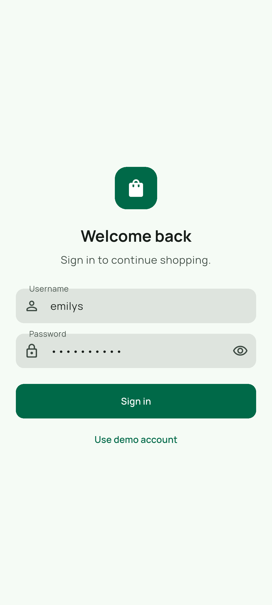 | 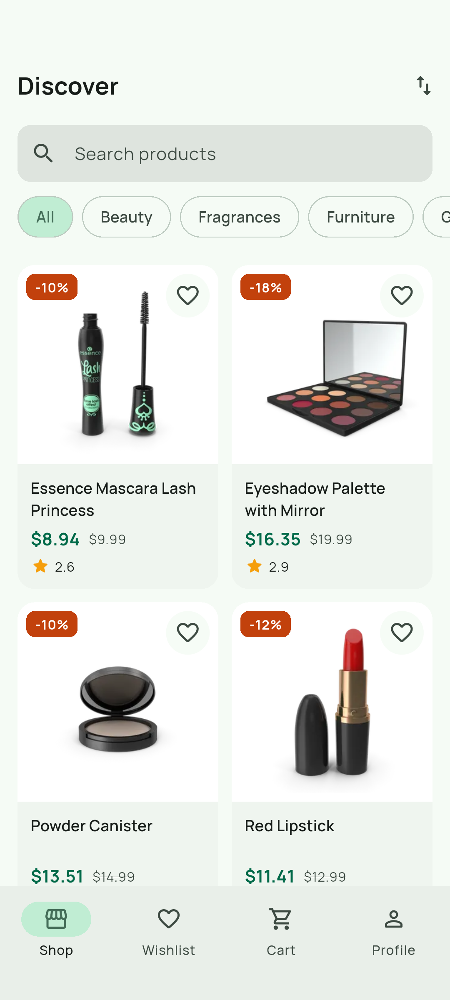 | 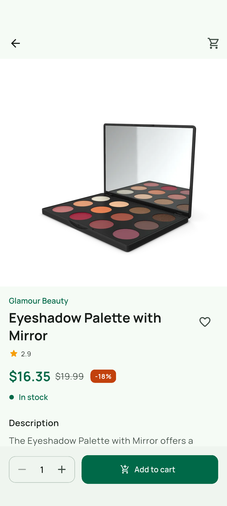 |
| **Search** | **Cart** | **Wishlist** |
| 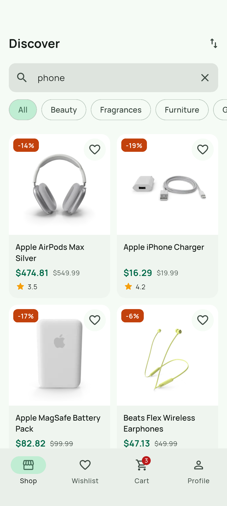 | 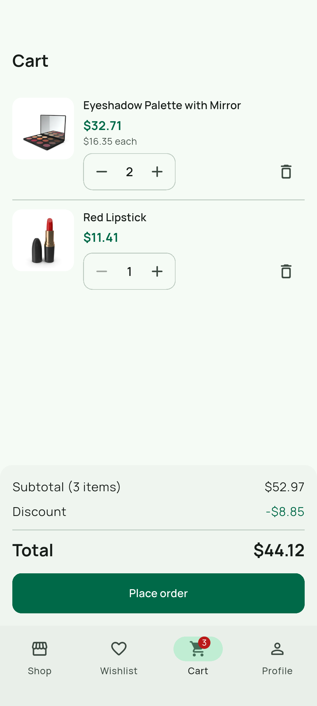 | 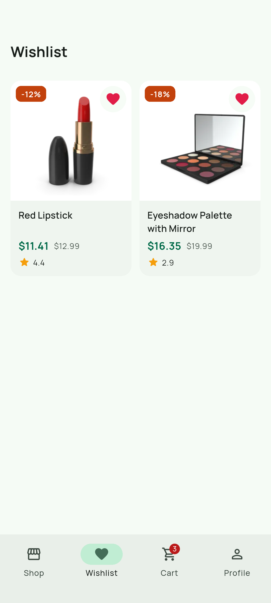 |
| **Profile** | **Dark mode** | **Order placed** |
| 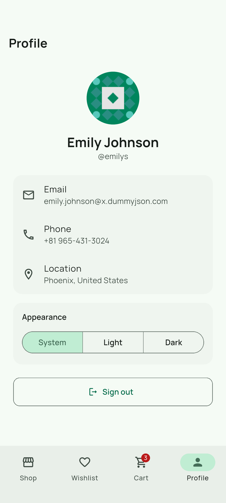 | 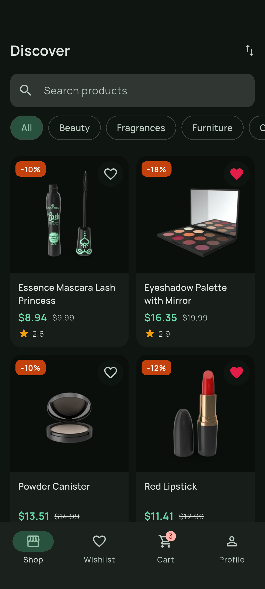 | 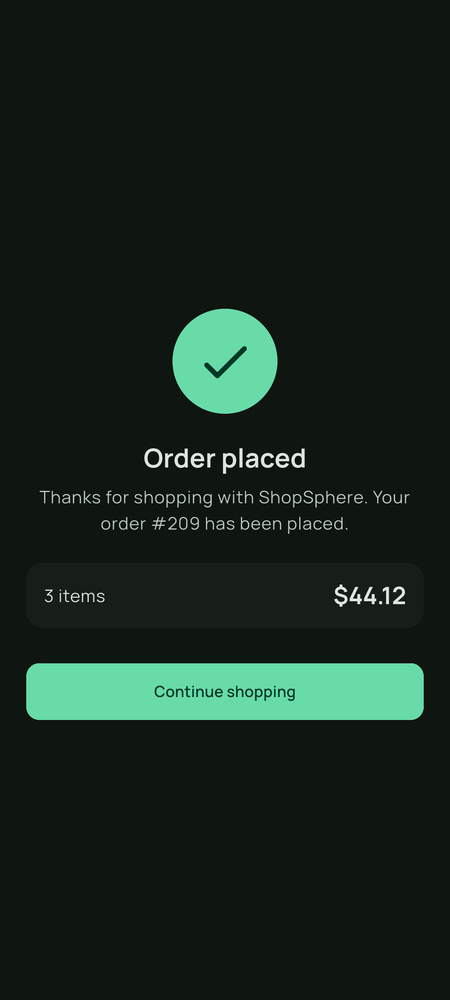 |

**Tablet, landscape**

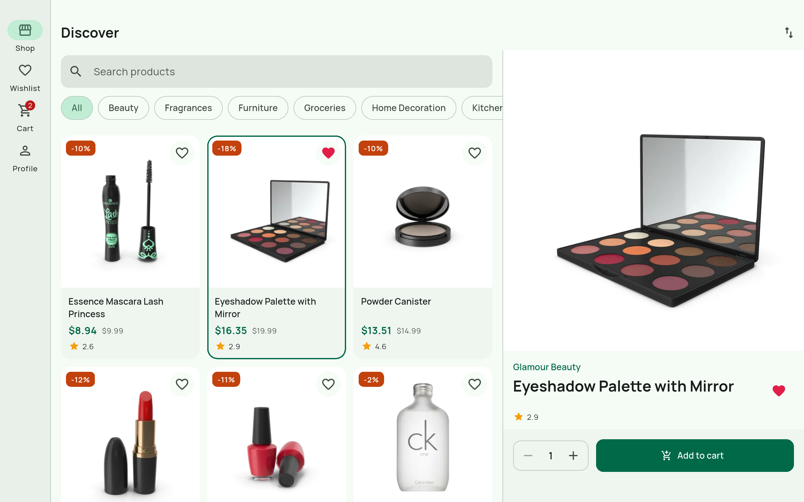

| Nothing selected yet | Cart |
| :---: | :---: |
| 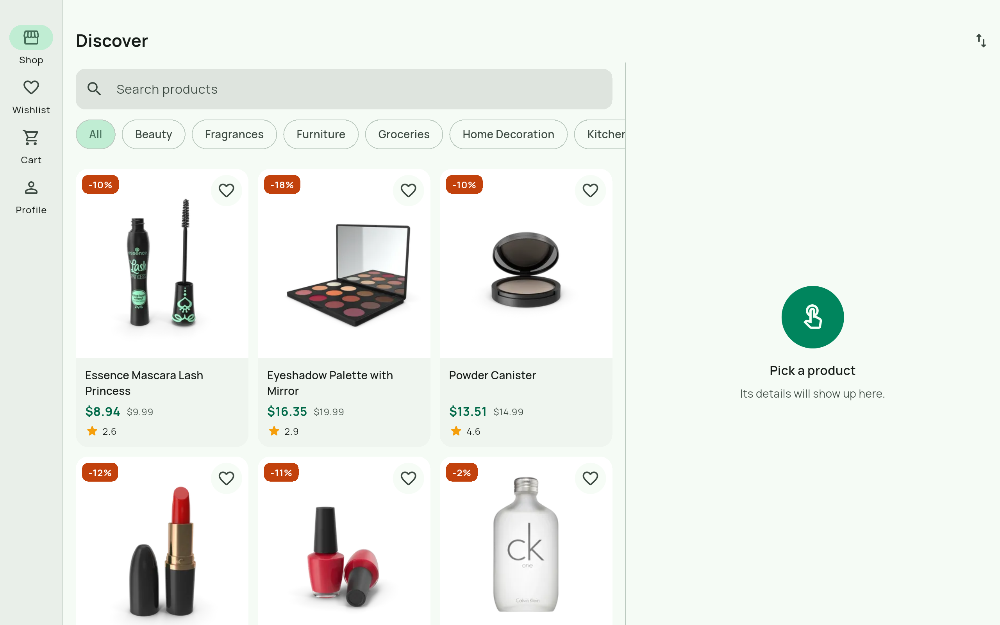 | 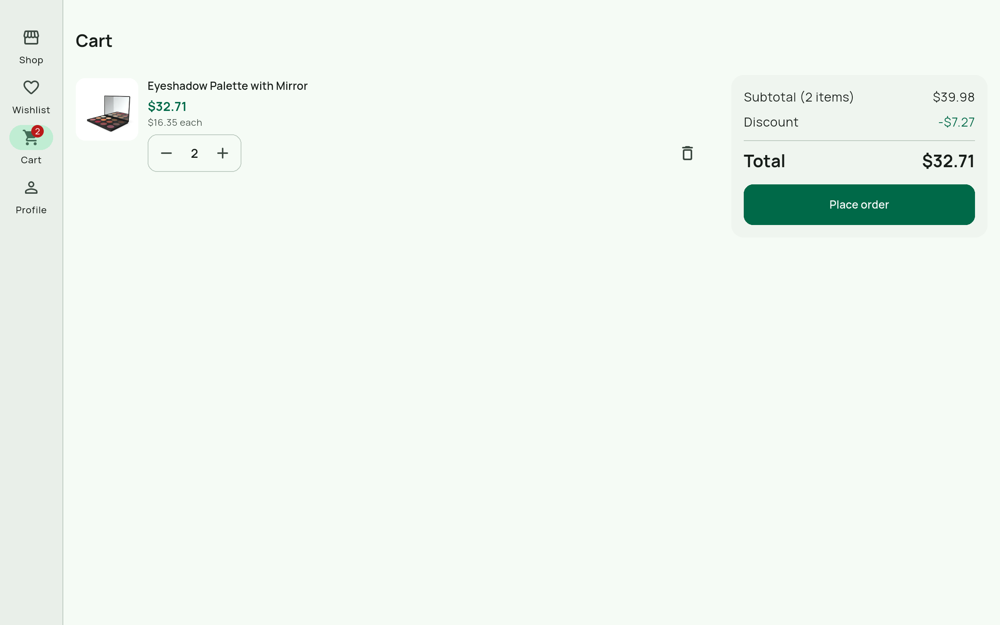 |

## Features

**Must**

- [x] Splash screen that restores a saved session and routes to Home or Login
- [x] Login with inline validation, password visibility toggle and a loading button
- [x] Tokens stored with `flutter_secure_storage`
- [x] Clear message for wrong credentials (HTTP 400)
- [x] Responsive product grid with thumbnail, title, price, discount and rating
- [x] Infinite scroll with `limit`/`skip` (page size 20), footer loader, stops at the end
- [x] Pull to refresh
- [x] Category chips loaded from the API
- [x] Search with a 400 ms debounce, using the search endpoint
- [x] Sort by price (both ways), rating and title
- [x] Shimmer placeholders on first load, and an empty state for no results
- [x] Product details: image carousel with page indicator, brand (when present), price and discount, rating, stock, description and reviews
- [x] Add to cart with a quantity selector, disabled when out of stock
- [x] "Product not found" state for missing products (404)
- [x] Cart: add, remove (with undo), change quantity; subtotal, discount and total
- [x] Cart saved locally, so it survives a restart
- [x] Live cart badge in the navigation bar and app bars
- [x] Place order through `POST /carts/add`, success screen, cart cleared
- [x] Profile from `GET /auth/me`: avatar, name, email, phone
- [x] Sign out clears tokens and local data and returns to Login
- [x] Signed out with a message when the session can't be renewed (401 / 403)

**Bonus**

- [x] Token refresh in a Dio interceptor, then the original request is retried
- [x] Hero animation from the product card to the details image
- [x] Light / dark / system theme, remembered between launches
- [x] Wishlist stored locally
- [x] Widget tests, including a layout and accessibility check on five screen setups
- [x] GitHub Actions CI running format check, `flutter analyze` and `flutter test`
- [ ] Offline mode with a cached product list (not done)
- [ ] Localization (not done)
- [ ] Golden tests (not done)

**Extras**

- Tablet layouts: a navigation rail from 600 dp, and the product list with its details side by side above 1024 dp.
- Checked at 1.3x font scale for overflows, tap target size, labels and text contrast.
- A "Use demo account" button on the login screen fills in the test credentials.

## Tech stack

- **Flutter 3.47.5** (stable), **Dart 3.13.4**
- Android: min SDK from Flutter's default (24), so it runs on Android 8.0 (API 26) and up

| Package | Why |
| --- | --- |
| `flutter_bloc` | State management; `BlocBuilder`, `BlocListener` and `context.select` keep rebuilds small. |
| `bloc_concurrency` | `droppable()` so fast scrolling can't request the same page twice. |
| `stream_transform` | `debounce` and `switchMap` for search: wait for typing to pause, cancel the stale request. |
| `equatable` | Value equality for states and entities, so identical states don't rebuild the UI. |
| `dio` | HTTP client with interceptors (used for the token refresh), timeouts and typed errors. |
| `get_it` | Service locator for dependency injection; widgets never build repositories themselves. |
| `flutter_secure_storage` | Keeps the access and refresh tokens in encrypted storage. |
| `shared_preferences` | Cart, wishlist, theme and the signed-in user. Small JSON values, so no database needed. |
| `cached_network_image` | Disk cache for product images, with placeholder and error widgets. |
| `shimmer` | Skeleton placeholders while the first page loads. |
| `flutter_lints` | Lint rules; `flutter analyze` reports no issues. |
| `bloc_test` | Checks the exact sequence of states a bloc emits. |
| `mocktail` | Mocks without code generation. |
| `flutter_launcher_icons` | Generates the app icons. |

The Manrope font is bundled in `assets/fonts`, so nothing is downloaded at runtime.

## Architecture

Feature-first clean architecture. Each feature has three layers, and the domain layer is plain Dart with no Flutter or HTTP imports.

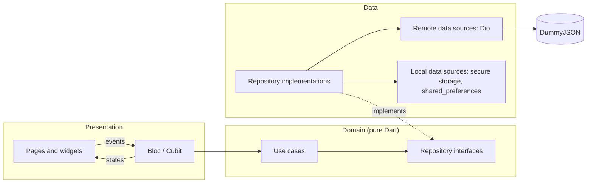

```
lib/
├── main.dart            # sets up dependencies and runs the app
├── app/                 # MaterialApp, auth-based routing, home shell (bottom bar or rail)
├── core/
│   ├── di/              # get_it registrations
│   ├── error/           # Failure types, Result, exception-to-failure mapping
│   ├── network/         # Dio client, auth interceptor, endpoints, session events
│   ├── storage/         # token and theme storage
│   ├── theme/           # colours, typography, ThemeData, ThemeBloc
│   ├── utils/           # breakpoints, formatters, validators, event transformers
│   └── widgets/         # ErrorView, EmptyView, shimmer, quantity selector, ...
└── features/
    ├── auth/            # splash, login, session
    ├── products/        # list, search, filters, sorting, details
    ├── cart/            # cart, checkout, order confirmation
    ├── profile/         # profile, theme switch, sign out
    └── wishlist/        # saved products
        # each one split into:
        #   data/          models (fromJson/toJson), data sources, repository implementations
        #   domain/        entities, repository interfaces, use cases
        #   presentation/  bloc or cubit, pages, widgets
test/                    # follows the feature folders of lib/, plus fixtures/ (sample JSON) and helpers/
```

**One request, end to end: searching for "phone"**

1. The search field's `onChanged` adds `SearchChanged('phone')` to `ProductsBloc`.
2. The bloc's `debounce` transformer waits 400 ms without new input, and cancels a search that is still running.
3. The bloc emits a `loading` state (the grid shows shimmer) and calls the `GetProducts` use case.
4. `ProductRepositoryImpl` asks `ProductRemoteDataSource`, which sends `GET /products/search?q=phone&limit=20&skip=0` through Dio. The auth interceptor adds the bearer token.
5. The JSON becomes `ProductsPageModel` and then domain entities. If anything throws, `guard()` turns it into an `Err` holding a `Failure`.
6. The bloc emits `success`, `empty` or `failure`, and the grid rebuilds with products, the empty state or an error view with a Try again button.

## State management

I used **flutter_bloc**. Every screen state is an explicit class (for example `ProductsStatus` is `initial`, `loading`, `success`, `empty`, `failure` or `loadingMore`), which makes the UI easy to reason about and lets `bloc_test` check the exact order of states. Events also give one place to control concurrency: search is debounced and restartable, and page loads are droppable. The cost is more boilerplate than Riverpod or Provider, with an event and a state class for each feature. The first features (auth, details, cart, profile) use Cubits, the lighter form for simple request and response screens. From the wishlist onwards I used Blocs only, to keep one style.

## Error handling

Data sources are allowed to throw. Repositories wrap every call in `guard()`, which catches the exception, maps it to a sealed `Failure` with a user-facing message, and returns a `Result` (`Ok` or `Err`). Blocs and widgets never see raw exceptions or stack traces.

| What happened | Failure | What the user sees |
| --- | --- | --- |
| No connection | `NetworkFailure` | "You're offline" view with Try again |
| Timeout (10 s connect, 15 s receive) | `TimeoutFailure` | "Taking too long" view with Try again |
| 404, e.g. `/products/9999` | `NotFoundFailure` | "Product not found" with a Back to shop button |
| 400 on login | `InvalidCredentialsFailure` | "Invalid username or password." under the form |
| 401 / 403 | `UnauthorizedFailure` | Handled by the interceptor first (see below) |
| 5xx or other status | `ServerFailure` | "Something went wrong" view with Try again |
| Unexpected JSON | `ParseFailure` | "Something went wrong" view with Try again |

Where the message appears depends on what is already on screen. A failed first load shows a full error view with a Try again button. A failed refresh keeps the current products and shows a snackbar. A failed next page shows "Couldn't load more products" with Try again in the list footer. Checkout errors show as a snackbar, so the cart stays as it was.

**Expired sessions.** `AuthInterceptor` is a `QueuedInterceptor`. On a 401 it calls `POST /auth/refresh` once, saves the new tokens and retries the original request. Requests that failed at the same time reuse that refresh instead of starting their own. If the refresh itself returns 401 or 403, the tokens are cleared and the app signs out with "Your session has expired. Please sign in again." A network error during the refresh keeps the user signed in and shows as being offline.

## Getting started

**Prerequisites:** Flutter 3.47.5 (stable channel), the Android SDK, and an emulator or device on Android 8.0 or newer.

```bash
git clone https://github.com/DevNebula6/prosessed-flutter-assignment.git
cd prosessed-flutter-assignment
flutter pub get
flutter run
```

There is no code generation step. The JSON models are written by hand.

To watch the token refresh happen, shorten the token lifetime to one minute, sign in, wait a minute, then pull down to refresh on the Profile tab:

```bash
flutter run --dart-define=TOKEN_LIFETIME_MINUTES=1
```

**Release APK**

```bash
flutter build apk --release
# build/app/outputs/flutter-apk/app-release.apk
```

Release builds are signed with the key described in `android/key.properties`. That file and the keystore are not in the repository; without them the build falls back to the debug key, so it still builds and installs. To sign with your own key, create `android/key.properties`:

```properties
storePassword=...
keyPassword=...
keyAlias=upload
storeFile=/absolute/path/to/upload-keystore.jks
```

## Testing

```bash
flutter test
flutter test --coverage   # writes coverage/lcov.info
```

**180 tests**, all passing, at **83.4% line coverage** (1638 of 1965 lines).

| Area | Coverage |
| --- | --- |
| `app` | 93.8% |
| `core` | 70.7% |
| `features/auth` | 90.5% |
| `features/cart` | 86.6% |
| `features/products` | 85.7% |
| `features/profile` | 85.2% |
| `features/wishlist` | 70.3% |

What is covered:

- **Use cases and entities:** login, product queries, cart totals and stock limits.
- **Blocs and cubits** with `bloc_test`, including pagination, debounced search and stale responses being dropped.
- **JSON models**, parsed from fixture files in `test/fixtures`.
- **Repositories**, including their failure paths, and the exception-to-failure mapping.
- **Auth interceptor:** refresh and retry, one refresh shared by parallel requests, sign-out when the refresh token is rejected, and staying signed in when the refresh can't get through.
- **Widget tests** for the main screens.
- **A layout test** that opens every main screen on five setups (small phone in light and dark, phone landscape, tablet portrait and landscape) at 1.3x text. It fails on overflows, small or unlabelled tap targets and low-contrast text.

CI runs a `dart format` check, `flutter analyze` and `flutter test --coverage` on every pull request and on pushes to `main`.

## Test credentials

| Username | Password |
| --- | --- |
| `emilys` | `emilyspass` |

The "Use demo account" button on the login screen fills these in.

## Assumptions and trade-offs

- **Search covers every category.** DummyJSON's search endpoint can't filter by category, so typing a query clears the selected chip, and picking a chip clears the search.
- **Sorting happens on the server** (`sortBy`/`order`), so it applies to the whole catalogue, not just the pages loaded so far.
- **The list asks only for the fields a card needs** (`select=`). The details screen fetches the full product.
- **Totals are worked out on the device** from price and discount percentage. `/carts/add` rounds discounted totals its own way, so the order screen shows the total the user saw in the cart. Prices are `double`s; a real store should use integer cents.
- **The splash restores the session from storage, without a network call,** so the app opens quickly and works offline. An expired token is refreshed by the first request that needs it.
- **Cart and wishlist are cleared on sign-out,** so the next person to sign in on the device starts fresh.
- **R8 keep rules.** `shared_preferences` and `package:jni` look up Kotlin classes by name over JNI, which R8 can't see. Without the rules in `android/app/proguard-rules.pro`, the release build stalled on the splash screen.

**With more time I would:**

- add the offline mode: cache the last product list and show a "You are offline" banner
- add English and Hindi translations with ARB files
- convert the remaining Cubits to Blocs, for one consistent style
- add golden tests, and run an integration test on an emulator in CI

## Use of AI tools

I took help from AI tools in parts of this project, such as writing tests. I went through every change before committing it, tested the app on phone and tablet emulators, and can walk through any part of the code.

## Author

**Vineet Prakash Diwakar**

- Email: [vineet.inbox26@gmail.com](mailto:vineet.inbox26@gmail.com)
- LinkedIn: [linkedin.com/in/vineet-prakash-diwakar](https://www.linkedin.com/in/vineet-prakash-diwakar)
- GitHub: [github.com/DevNebula6](https://github.com/DevNebula6)
